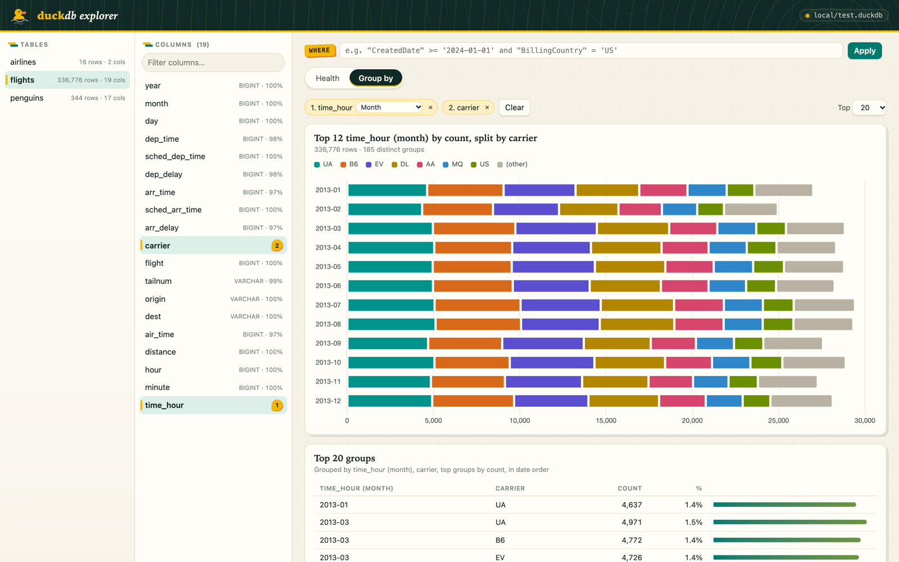
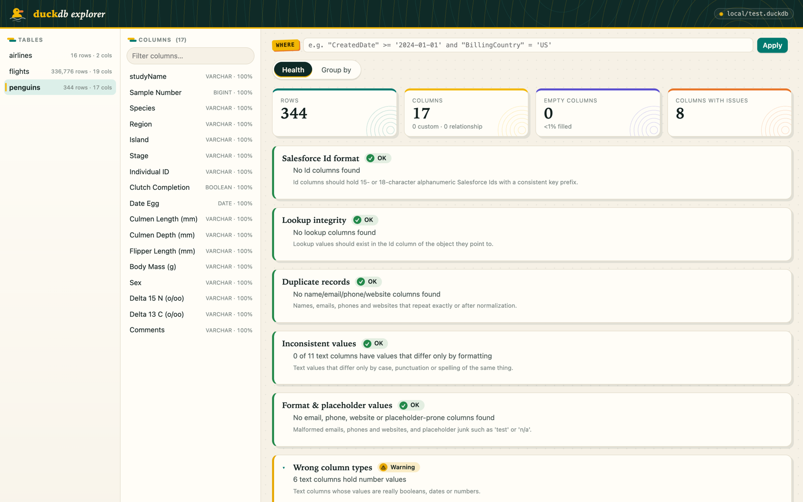
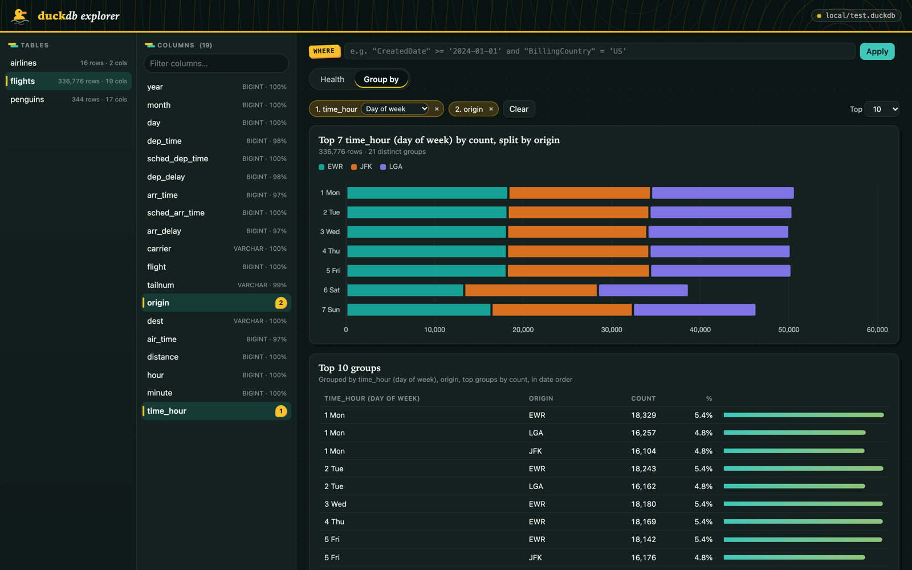
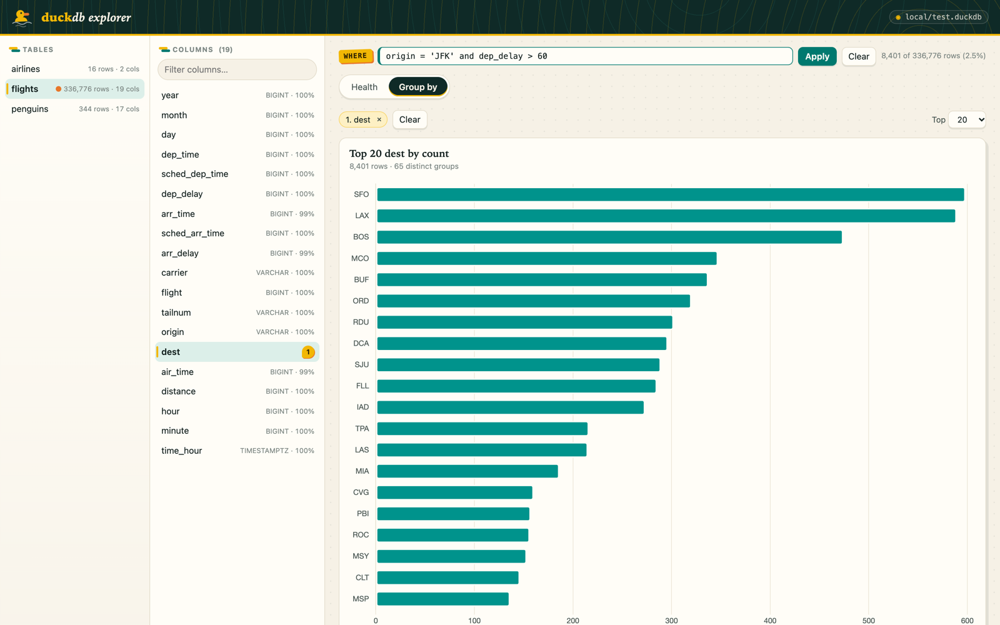

# DuckDB Explorer

A small local web app for browsing a DuckDB database: pick a table, profile its columns, run Salesforce-flavored data-quality checks, and chart group-by counts. It is one Python file serving one HTML page, with no build step.



_Screenshots use public datasets: [nycflights13](https://github.com/tidyverse/nycflights13) and [Palmer Penguins](https://github.com/allisonhorst/palmerpenguins)._

## Run it

Requires [uv](https://docs.astral.sh/uv/). Dependencies (`duckdb`, `pytz`) are declared inline in `app.py` and installed by uv on first run.

```bash
uv run app.py path/to/db.duckdb              # opens http://127.0.0.1:8765/ in your browser
uv run app.py path/to/db.duckdb --port 8800  # different port
uv run app.py path/to/db.duckdb --no-browser # don't auto-open a browser
```

The database is opened **read-only**, and the server only listens on `127.0.0.1`.

## Using it

The screen has three panes: **Tables**, **Columns** for the selected table, and the main view with two tabs.

### Health tab

- **Summary tiles:** row count, column count (custom `__c` and relationship columns broken out), empty columns, and columns with issues.
- **Salesforce checks:** Id format, lookup integrity (orphaned Ids), duplicate records, inconsistent values (same value with different case or punctuation), format and placeholder values (bad emails, phones and websites, junk like `test` or `n/a`), and mistyped columns (text that is really a boolean, date or number). Each check shows OK, Warning or Issue, with example values.
- **Column profile:** fill %, nulls, blanks, distinct count, min/max and flags for every column. Filter by kind or name, and sort by any header. Click a row for its top values; from there, **Group by this column** jumps to the Group by tab.



### Group by tab

- **Click** a column to group by just that column. Clicking it again clears it.
- **Ctrl+click** (or Cmd+click) to add a column to the grouping, or remove one. The first column is the chart's axis; the rest split each bar into colored segments, with the top 7 series kept and the rest folded into `(other)`.
- **Top N** (5–100) sets how many groups to show, ranked by count. Groups are always listed in descending count: with several columns, the table is ordered by the first column's total, then by each sub-group's subtotal within it. When a bucketed date column comes first, its periods are shown in date order instead (sub-groups still by count). Periods with low counts can drop out of the top N and leave gaps in the timeline, so raise **Top** to see a full range.
- **Date and timestamp columns** get a dropdown on their chip, set to Month by default:
  - Timeline: Year, Quarter, Month, Week (ISO, e.g. `2024-W38`), Day, Hour
  - Cycle: Month of year, Week of year, Day of week, Hour of day
  - Exact value: the raw value



### WHERE filter

The **WHERE** box above the tabs takes any DuckDB boolean expression, e.g. `"CreatedDate" >= '2024-01-01' and "Incoming"`. It scopes every view to the matching rows and shows how many rows matched.

- **Ctrl+Space** opens suggestions: column names (fuzzy matched), SQL keywords, and, after a comparison operator, that column's most common values.
- The filter is saved per table in the browser's local storage. Tables with a saved filter show an orange dot in the Tables pane.



### Links

The URL hash records the table, tab, selected columns, date buckets, Top N and WHERE clause, so a link or bookmark reopens the same view.

## Files

| File | What it does |
|---|---|
| `app.py` | HTTP server and query layer: table and column listing, group-by (with date buckets and stacked series), WHERE validation |
| `sfchecks.py` | Column profiling and the Salesforce-specific checks |
| `index.html` | The whole UI: plain JS, [Chart.js](https://www.chartjs.org/) from cdnjs, and the "duck pond" light/dark theme |

## API

All endpoints are `GET` and return JSON. Table-scoped endpoints take `schema` and `table`, plus an optional `where`. Errors come back as `{"error": "..."}` with status 400.

| Endpoint | Params | Returns |
|---|---|---|
| `/api/info` | | `{db}` |
| `/api/tables` | | tables and views, with column and row counts |
| `/api/columns` | `schema`, `table` | `[{name, type}]` |
| `/api/groupby` | `cols` (JSON array), `grains` (JSON object: column to bucket, optional), `limit` (1–100) | `{columns, total, distinct, rows, stack}` |
| `/api/profile` | | per-column profile |
| `/api/sfchecks` | | Salesforce check results |
| `/api/where` | `where` | `{where, total, matched}` after validating the clause |

Bucket names for `grains`: `year`, `quarter`, `month`, `week`, `day`, `hour`, `month_of_year`, `week_of_year`, `day_of_week`, `hour_of_day`.

## Notes

- Large tables (millions of rows) can take a few seconds to profile. Group-by queries run directly on the table, and DuckDB handles them quickly.
- The theme follows your OS light/dark setting.
